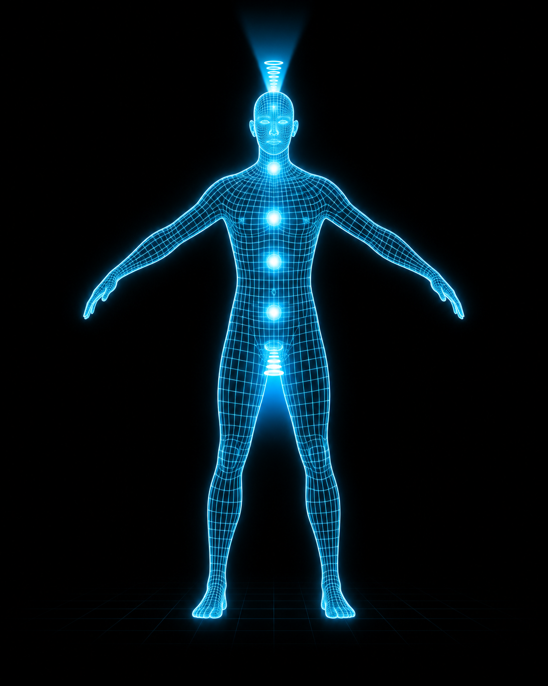
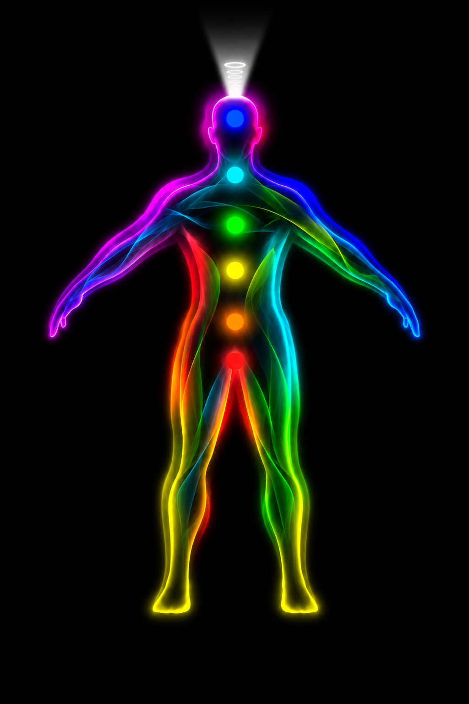

# Museum of Fields — Interactive Art Laboratory

A set of independent interactive web-art experiments. The project root and the human-mesh experiment are separate.

## Live pages

- [Original V1.2 — Isolated Light](https://bianen.github.io/ui-motion-lab/) — original standalone light field; unaffected by V1.7.
- [V1.7.1 — Human Photon Field](https://bianen.github.io/ui-motion-lab/experiments/human-mesh/) — anatomically sourced 3D particle sculpture in one offline-capable HTML page.

## V1.7.1 approved configuration

| Parameter | Selection |
|---|---|
| 3D source | MakeHuman |
| Photons | 18,000 |
| Surface distribution | Approximate blue noise (Poisson-rejection) |
| Particle size | Fine |
| Lighting / color | Halo; cool white and violet |
| Move | Scatter outward velocity |
| Hold | Charge energy |
| Release | Expanding Shockwave |
| Return | Slow, inertia-based |
| Trails | Short, translucent Canvas history |
| Rotation | 360° orbit (Shift + left drag, or right drag) |
| Background | Ambient violet-black |
| Renderer | Offline Canvas 2D |

Normal pointer movement scatters particles. Hold the **left mouse button** to accumulate charge; releasing launches a travelling shockwave. To keep orbit separate from Charge, **Shift + left drag** or **right drag** rotates the body; mouse wheel zooms. Touch supports Move / Hold / Release.

The viewer is generated, not hand-edited. The bake_points.py script loads a real CC0 MakeHuman-derived GLB, samples its triangle surface with trimesh.sample.sample_surface_even using approximate blue-noise spacing, then packs all 18,000 photon positions and surface-luminance bytes into the experimental index.html. The page needs no runtime model file, WebGL, Three.js, npm, or network requests.

The implementation exposes modular CONFIG, PHYSICS, and VISUALS, plus dedicated applyScatter, applyCharge, applyShockwave, applyReturn, project, and renderPhotons functions. It reports an inspectable window.photonDebug object.

### Sources and licenses

- Primary local GLB: experiments/human-mesh/assets/makehuman_base_male.glb (4.5 MB, approximately 109,064 triangles), a CC0 MakeHuman-derived male A-pose mesh from [Innerscene](https://www.innerscene.com/tools/library/3d-parts/male-base-mesh-3d-person-rigged-a-pose-380e6d89).
- Backup mesh: experiments/human-mesh/assets/human_posed.glb, a CC0 Quaternius humanoid from [UMRAM-Bilkent](https://github.com/UMRAM-Bilkent/supine-human-model).

### Build and deployment

The build-photons.yml GitHub workflow bakes positions, checks syntax, simulates pointer physics with smoke_test.cjs, then commits the independent experiment page. The pages.yml workflow publishes the entire repository on GitHub Pages. The root index.html is never changed by the experiment build.

### V1.7 release verification

The standalone renderer is baked to 18,000 points and has passed GitHub Actions syntax and pointer-physics smoke checks. The physics module bounds displacement to 0.38 normalized body-height units; CI's scripted interaction measured approximately 177 px maximum displacement in a 1440×900 test view. The original root/index.html is unchanged.

### V1.7.1 interaction refinement — 2026-11-12

The model, 18,000 blue-noise photon samples, palette, Canvas renderer, slow return and original main page remain unchanged.

- **Soft contact:** a per-photon exponential contact envelope ramps outward force in over **220 ms** instead of applying a full impulse on initial contact; fade-out takes 95 ms.
- **Pointer velocity filtering:** measured pointer speed is frame-rate normalized and smoothed by a **95 ms** exponential filter; raw movement is not applied directly. Stale motion starts decaying after 75 ms without an event.
- **Move scatter:** radius **130 px**, outward speed impulse **0.0032**, smoother radial influence.
- **Release shockwave:** maximum impact radius **220 px**, speed **11 px / 60-Hz reference frame**, annular width **28 px**, velocity strength **0.004**. A strict 220-pixel boundary prevents force beyond that radius.
- **Displacement limit:** reduced from 0.38 to **0.26** normalized model height, keeping the figure intact after repeated gestures.
- **Return:** existing slow spring and damping rates preserved.
- CI tests exercise contact onset versus steady contact, cursor idle decay, local shockwave radius, orbit, original body data and standalone offline rendering.

To inspect running diagnostics, use `window.photonDebug` in a browser's developer console.

## Design inspiration favorites / 设计灵感收藏库

- **[打开收藏索引｜Favorites](references/favorites/README.md)** — Curve Gallery、When Cells Collide、Active Theory；含技术拆解、可否改造/商用的许可提醒与学习路线。用编号 `FAV-001` 等随时引用。

## 3D Spirit Bodies · 可视化建模图库

蓝色网光体（01）与彩虹流光体（02）的多视角参考素材已经建立独立编号，网页支持逐张查看。

**[打开 3D 灵体图片画廊](assets/spiritual-bodies/gallery.html)** · **[查看编号式图像索引](assets/spiritual-bodies/README.md)**

| 01 蓝色网光体 · A版 | 02 彩虹流光体 · A版 |
|:--:|:--:|
|  |  |
| [01 · 9 张已校验高清图片](assets/spiritual-bodies/01-blue-wireframe-light-body/README.md) | [02 · 5 张高清参考图（4 主视角 + 1 AUX）](assets/spiritual-bodies/02-rainbow-flow-body/README.md) |

*说明：01 的全部 9 张高清图已经入库；02 也已正式入库原始 JPG 和 5 张独立高清 PNG。所有 AI 生成的多角度图片仍是视觉参考，而非经 3D 母模型校准的正交视图。*

### 02 Rainbow Flow Body · Code-Ready Pilot / 纯代码 3D 打板

- **[运行 Three.js 3D 原型](https://bianen.github.io/ui-motion-lab/assets/spiritual-bodies/02-rainbow-flow-body/prototype/)** — 16 条三维流光、6 个节点、独立图层、可切换摄像机及 Bloom 调参。
- [02 结构与试评分报告](assets/spiritual-bodies/02-rainbow-flow-body/review/README.md) · [机器可读模型参数 JSON](assets/spiritual-bodies/02-rainbow-flow-body/review/asset-spec.json) · [全项目 3D-ASSET-REVIEW-V1 审核标准](assets/spiritual-bodies/3D-ASSET-REVIEW-V1.md)

*Pilot / DRAFT: 这是基于多视图的三维建模假设，不是最终精确复刻，也没有通过 Stage A / B 入库验收。*

## Claude 3D Codegen Lab · 代码生成实操手册（2026-11-20）

- **[进入 Claude 3D 代码生成资料库](research/claude-3d-codegen/README.md)** — Three.js 互动网页、确定性代码视频、Blender Python、混合方案。
- **[给 Claude Code 的入口说明](research/claude-3d-codegen/CLAUDE.md)** — 直接读仓库内提示词、案例、场景需求模板和 QA 标准。
- [完整工程提示词与实操工作流](research/claude-3d-codegen/docs/engineering-prompts-and-workflows.md) · [可视化 HTML 工作台](research/claude-3d-codegen/workbench/index.html) · [开源案例研究库](research/claude-3d-codegen/data/open-source-case-database.md)

用 Claude Code 打开本仓库后，输入：`Read research/claude-3d-codegen/CLAUDE.md first and follow its instructions.`

### 03 黄色网光体 · Yellow Wireframe Light Body — A 版高清图

- [03 高清图片图库](assets/spiritual-bodies/03-yellow-wireframe-light-body/README.md) · [全套 A 版 ZIP](assets/spiritual-bodies/03-yellow-wireframe-light-body/version-A/03-yellow-wireframe-light-body-A-package.zip) · [统一网页画廊](assets/spiritual-bodies/gallery.html)
- 正视、右侧、背视、45°主视角 + 高角度 AUX；脉轮沿身体内部中轴的修正版。纯图片资料，无 3D 代码改动。
