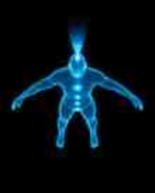
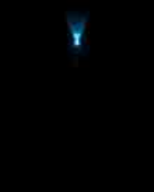

# 01 蓝色网光体 | Blue Wireframe Light Body

**Version A · 忠实复刻 / Faithful Reference** · [打开网页画廊](../gallery.html) · [返回资产总目录](../README.md)

## 独立图片预览（点击可打开单张）

| 图像 | 图像 | 图像 |
|:---:|:---:|:---:|
|  **原图 / Original** |  **正视图 / Front** |  **右侧视图 / Right side** |
|  **背视图 / Back** |  **45°透视 / 3/4 view** |  **高角度 / Top-oblique** |
|  **独立网格 / Wireframe** |  **发光节点 / Energy nodes** |  **头顶光束 / Head beam** |

> **预览说明**：以上是 GitHub 内可直接显示的低分辨率浏览缩略图。单张高清 PNG 尚未上传 GitHub；当前仍保存在聊天内的完整 ZIP 素材包。不要将这些缩略图误当作建模用原始高精度参考图。

## 建模用途与文件约定

| 类别 | 高清文件名 | 用途 |
|---|---|---|
| 原图 | `source/01-original-reference.jpg` | 源造型及比例参照 |
| 正面 | `version-A/views/01-front.png` | 正面轮廓、人体姿态和光点位置 |
| 右侧 | `version-A/views/02-right-side.png` | 身体前后深度的视觉假设 |
| 背面 | `version-A/views/03-back.png` | 背部网格的视觉假设 |
| 45° | `version-A/views/04-three-quarter.png` | 体积与网格视觉参考 |
| 高角度 | `version-A/views/05-top-oblique.png` | **非正交俯视**，仅用于构图参考 |
| 人体网格层 | `version-A/layers/01-wireframe-only.png` | 轮廓、拓扑视觉参考 |
| 发光节点层 | `version-A/layers/02-energy-nodes.png` | 纵向节点布局 |
| 头顶光束层 | `version-A/layers/03-head-beam.png` | 锥形光束与环形结构 |

**工程注意**：这些图片彼此由图像生成独立推断，不是从同一个已建立的 3D 模型渲染。正式 Blender 建模前，须以原图和统一人体母模型校正尺寸、坐标、节点深度、手足姿态。之后使用共同相机系统渲染真实正交多视图。

### 后续待补
- 将高清 PNG/JPG 按上面路径逐个上传到仓库，替换仅预览状态；保留缩略图用于快速浏览。
- 完成母模型、可编辑 Mesh/Curves、Shader、Blender 文件和 GLB 导出。
