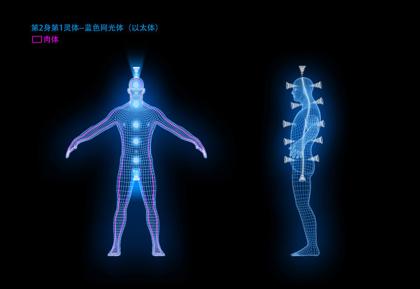
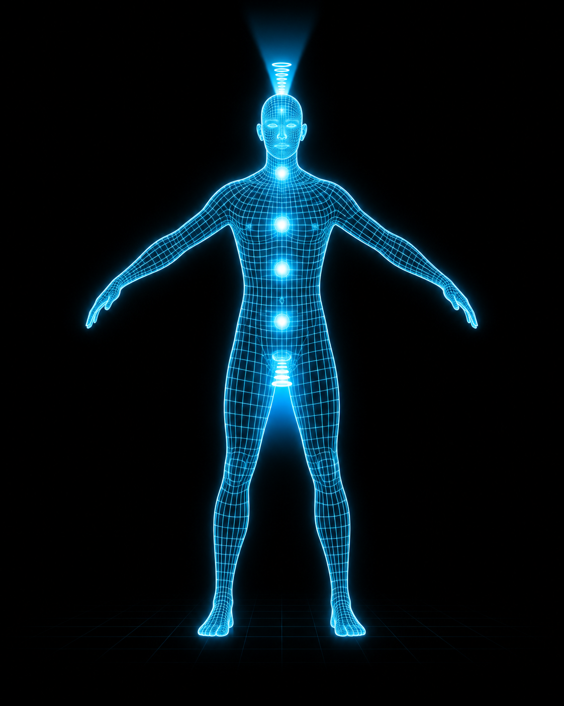
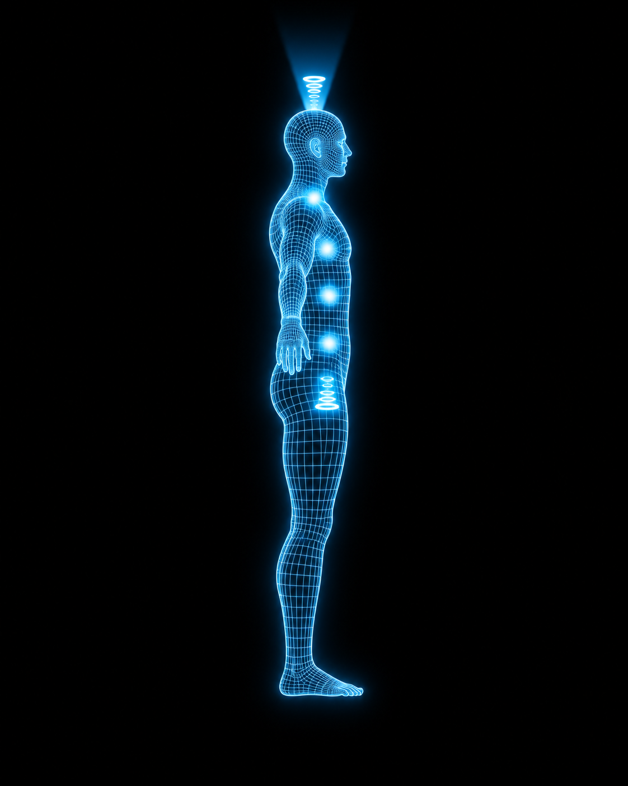
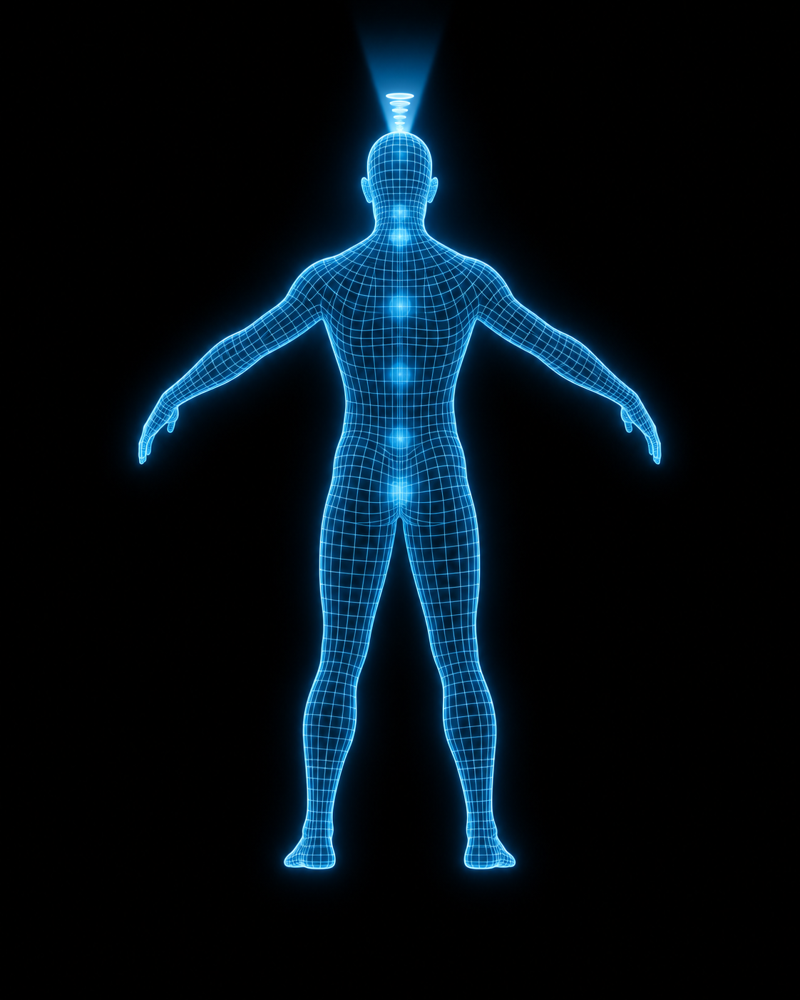
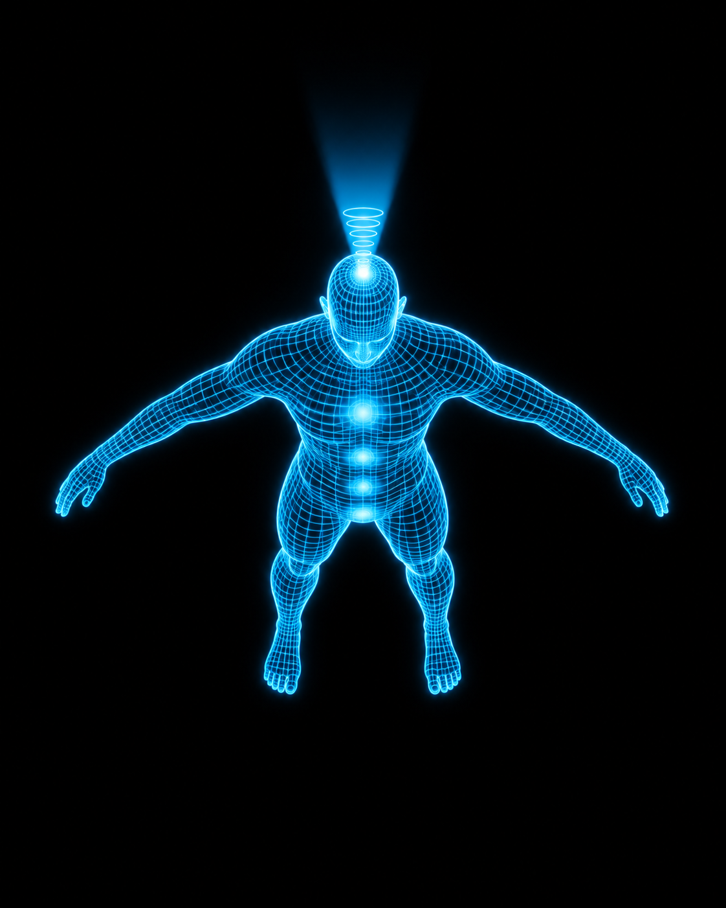
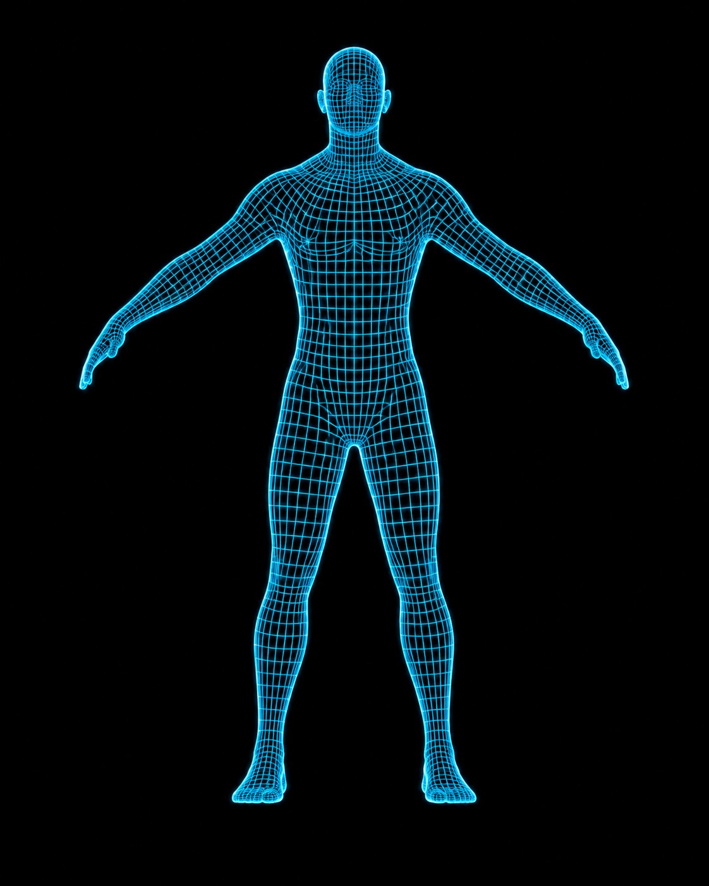
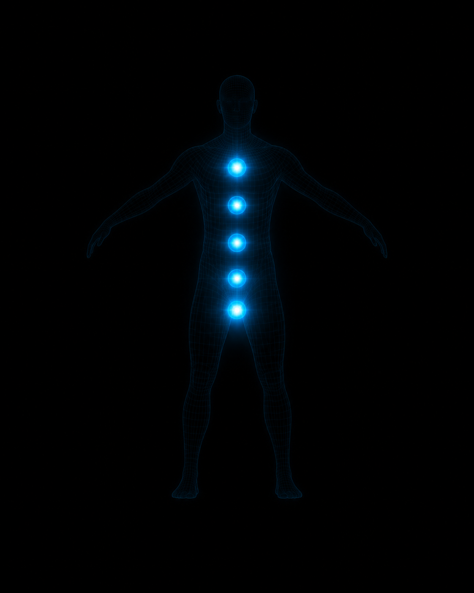
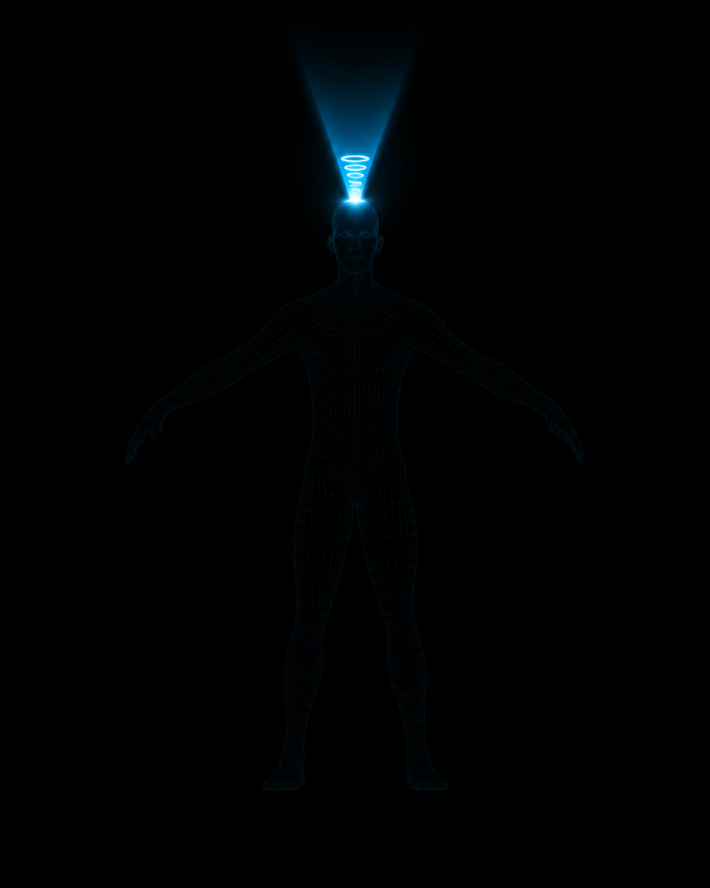

# 01 蓝色网光体 / Blue Wireframe Light Body

**A 版 · 忠实复刻 / Faithful Reference** · [网页独立浏览](../gallery.html) · [资产库首页](../README.md)

**状态：高清原文件已上传并通过 SHA-256 验证。** 1 张原始 JPG + 8 张原始尺寸 PNG（1122 × 1402），总计 7,373,683 字节。每张图片拥有独立的 GitHub 文件地址，不再依赖缩略图或外部链接。

## 高清原图浏览（点击单张打开）

| 原始图与各独立视角（点击打开高清原文件） |  |  |
|:---:|:---:|:---:|
|  **原图 / Original** |  **正视图 / Front** |  **右侧视图 / Right side** |
|  **背视图 / Back** |  **45°透视 / 3/4 view** |  **高角度 / Top-oblique** |
|  **独立网格 / Wireframe** |  **发光节点 / Energy nodes** |  **头顶光束 / Head beam** |

## 3D 建模资产定位

| 文件 | 用途 |
| --- | --- |
| [原始原图](source/01-original-reference.jpg) | 保留用户上传的原始设计与正面/侧面概念画 |
| [正视图](version-A/views/01-front.png) | 比例、正面人体与光节点参考 |
| [右侧图](version-A/views/02-right-side.png) | 侧向深度和身体比例参考 |
| [背视图](version-A/views/03-back.png) | 背部轮廓视觉假设 |
| [45°图](version-A/views/04-three-quarter.png) | 整体体积、透视感参考 |
| [高角度图](version-A/views/05-top-oblique.png) | 顶部高角度**非正交**视图参考 |
| [纯网格层](version-A/layers/01-wireframe-only.png) | Mesh/Wireframe 建模 |
| [发光节点层](version-A/layers/02-energy-nodes.png) | 独立节点几何/Shader |
| [头顶光束层](version-A/layers/03-head-beam.png) | Cone/Volumetric Light/Shader |

**技术限制：** 这些图是逐张生成的视觉参照，不能保证人体拓扑、节点在三维空间中的位置完全一致。它们**不是从统一 Blender 模型渲染的正交六视图，也不是 3D 网格文件**。正式建模应以原图锁定人体比例，统一世界坐标、骨架和姿态，再使用同一模型输出一致的 Front/Side/Back/Top/45° 图。

## 版本与验证

- `version-A/views/` 存放独立视角 PNG；`version-A/layers/` 存放独立光效/网格层 PNG。
- `source/` 保存原始参考 JPG。
- `import-sources.json` 记录此批原始二进制导入的源 URL、大小和 SHA-256。GitHub Actions 导入时核对完整哈希且全部通过。
- `previews/` 的小尺寸图仅保留作为轻量索引，**不是**建模母图。
- 将来另开 `version-B/` 存储高精度升级版，不覆盖 A 版。
