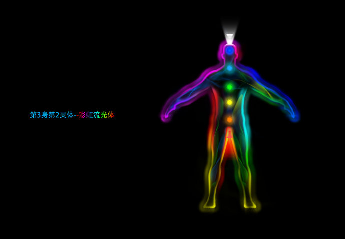
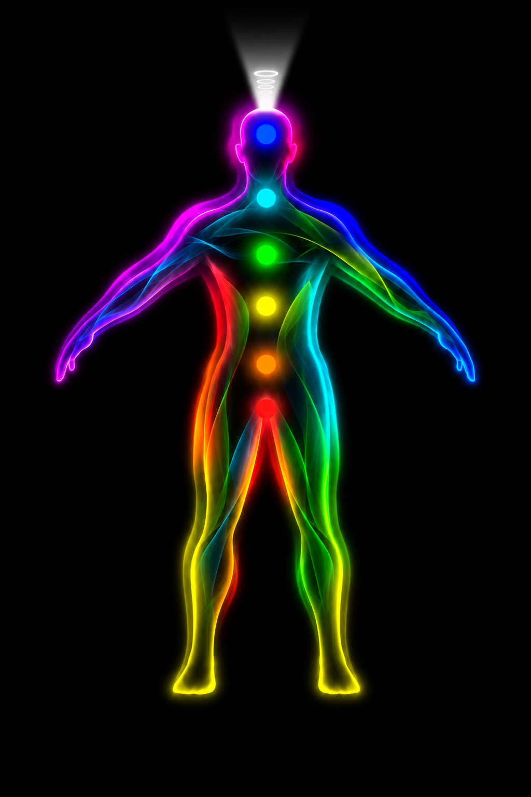
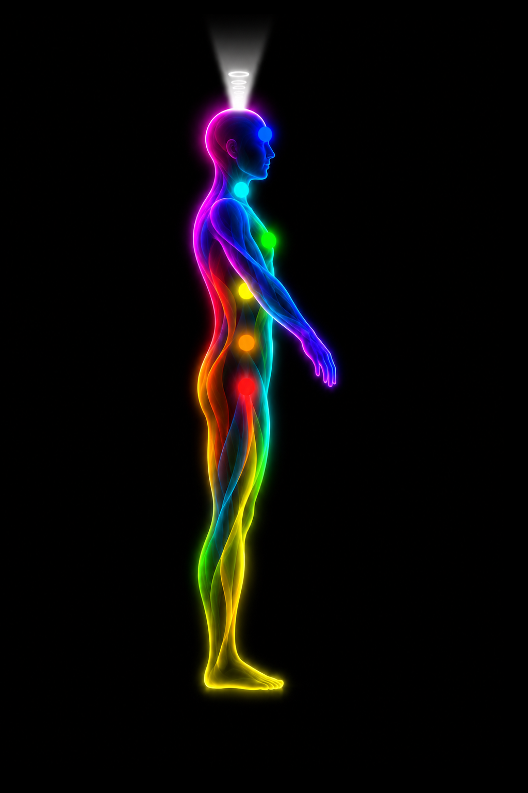
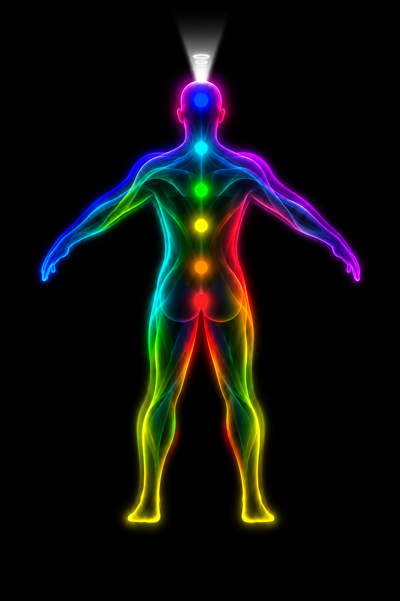
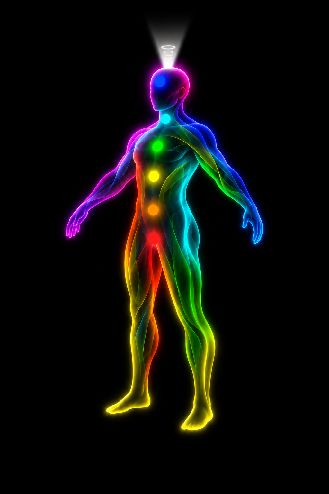

# 02 彩虹流光体 | Rainbow Flow Body

**A 版 · 忠实复刻多视角图片** · **用户已确认正式归档** · [返回图片总目录](../README.md) · [网页图片画廊](../gallery.html)

本页只展示图片资产，不将 3D 程序截图混入参考库。点击下方任意图可直接查看完整分辨率。

## 高清原图与五张独立多视角图

| | | |
|:---:|:---:|:---:|
|  **00 原始图** Original source |  **01 正视图** Front · Primary |  **02 右侧图** Right side · Primary |
|  **03 背视图** Back · Primary |  **04 45°图** Three-quarter · Primary |  **05 高角度辅助图** Top-oblique · AUX |

## 入库分类

| 资产 | 文件 | 用途 |
|---|---|---|
| 原始来源 | [00 原图](source/00-original-reference.jpg) | 保留原艺术图，原样 JPG |
| 主视角 1 | [01 正视图](version-A/views/01-front.png) | 彩虹结构正面与光核位置 |
| 主视角 2 | [02 右侧图](version-A/views/02-right-side.png) | 身体深度的生成参考 |
| 主视角 3 | [03 背视图](version-A/views/03-back.png) | 背面流线生成参考 |
| 主视角 4 | [04 45°图](version-A/views/04-three-quarter.png) | 三分之四角度参考 |
| **AUX 辅助视角** | [05 高角度](version-A/views/05-top-oblique-AUX.png) | **非正交俯视，不作为标准 Top 视图** |

### 重要标注

- 本次仅归档用户认可的 2D 参考图：原始 JPG 加五张独立 PNG（各为 **1024 × 1536**）。
- 五张生成参考图是基于原始灵体的多视角艺术推断，**尚未由同一 3D 模型校准**。不能当作精准空间测量或真实正交制图。
- 仓库中此前已有的 `prototype/` 3D 实验代码与渲染截图不是本次正式图片内容，本次**没有更改或运行它们**。
- [SHA-256 入库清单](archive-import.json) 保留图片来源、文件大小与校验值；归档工作流在上传每张高清图前进行字节与哈希校验。
- 未来 B 版另设目录，不覆盖 A 版。
