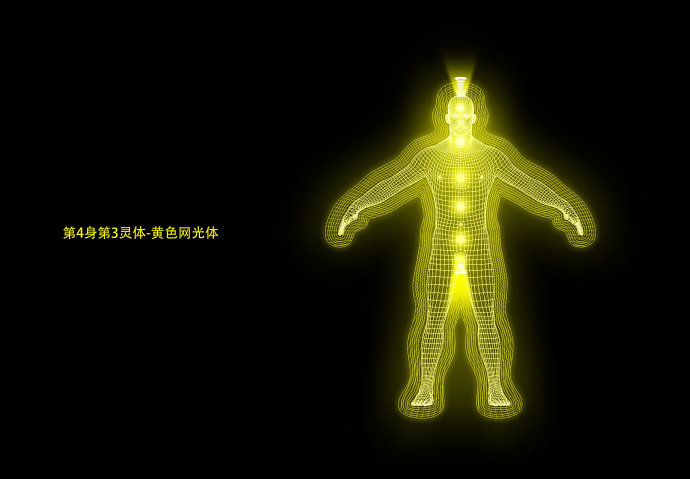
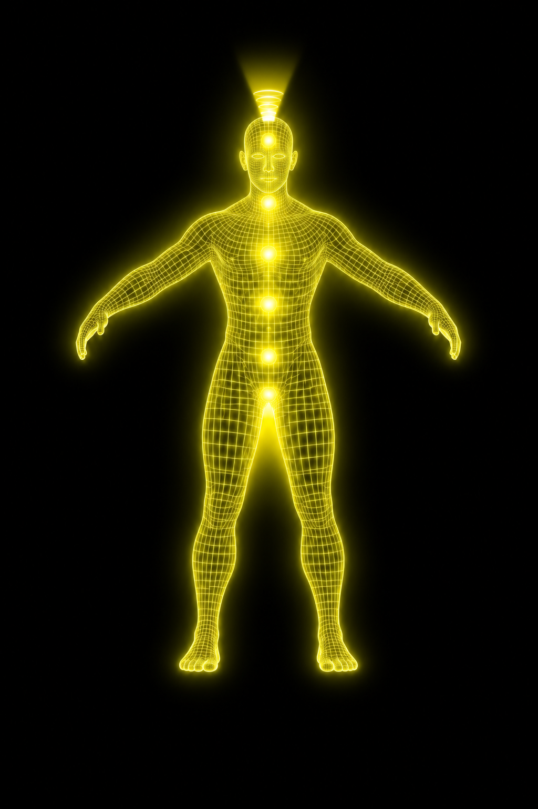
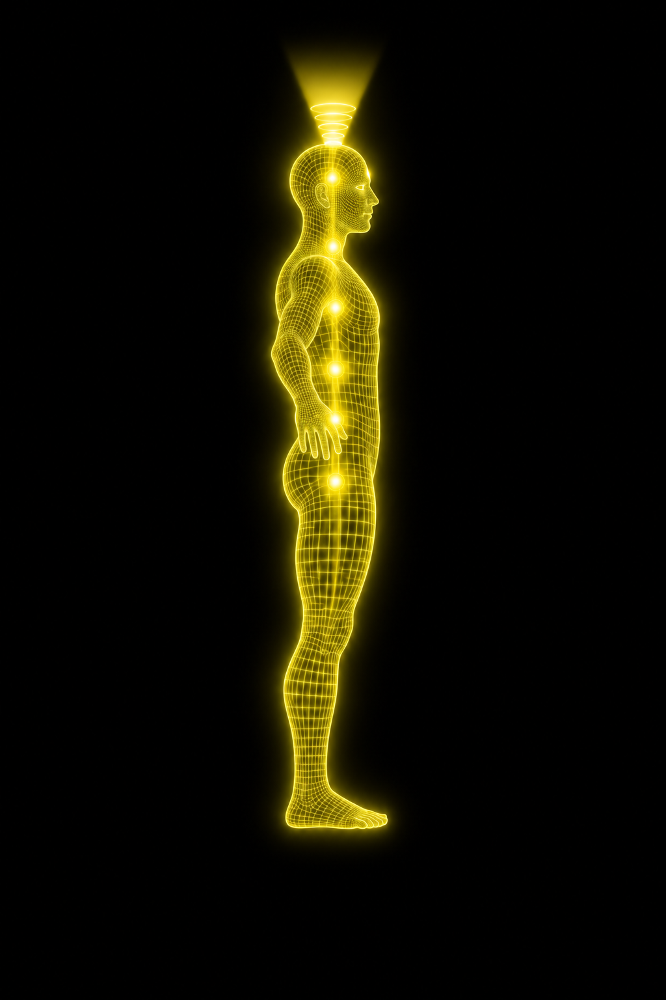
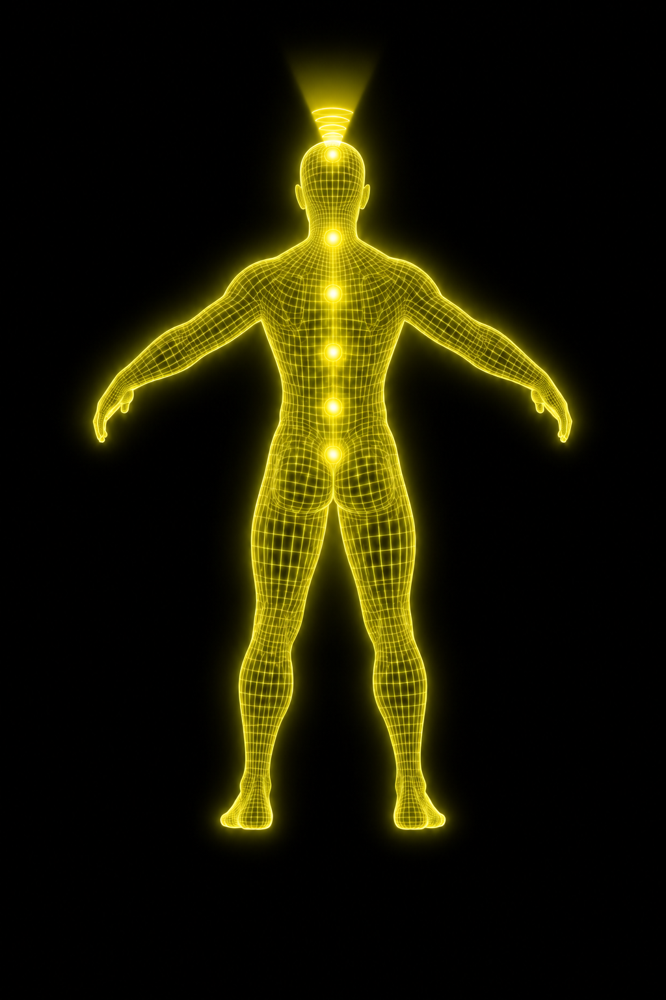
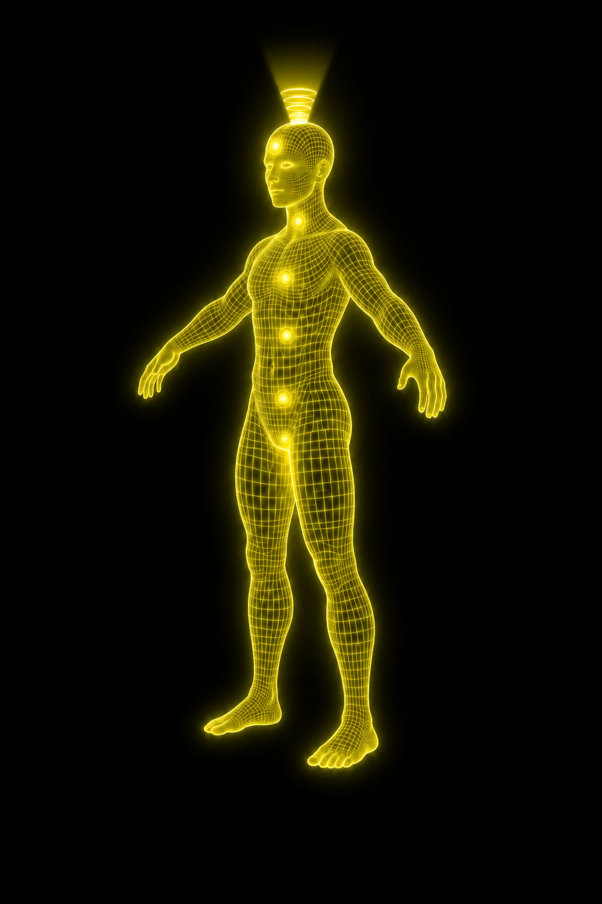
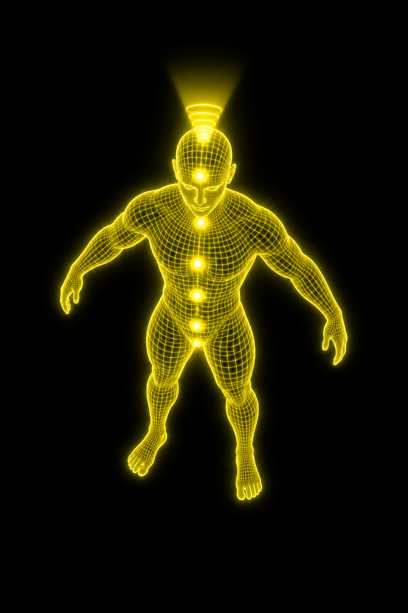

# 03 黄色网光体 | Yellow Wireframe Light Body

**Version A · 脉轮置于身体内部中轴的修正版 · 已确认入库**

[返回 01–03 图库总目录](../README.md) · [打开网页画廊](../gallery.html)

本目录只收录原始二维参考图与五张独立高清多视角图片，不包括 3D 模型、代码或交互程序。

**[一键下载整套 A 版图片 ZIP](version-A/03-yellow-wireframe-light-body-A-package.zip)**（5 张高清多视角 PNG + README）

## 高清图库

### 原始参考图 / Original

### 正视图 / Front

### 右侧视图 / Right side

### 背视图 / Back

### 45°斜视图 / Three-quarter

### 高角度 AUX / Top-oblique auxiliary

## 文件分类

- 原图：`source/00-original-reference.jpg`，保持原始 JPG 不变。
- 四张主视角：`version-A/views/01-front.png` 至 `04-three-quarter.png`。
- 一张 AUX：`version-A/views/05-top-oblique-AUX.png`。高角度属于透视参考，不是正交顶视图。
- **修正关键点：** 脉轮/能量节点应沿身体内部中轴分布，尤其侧面不可误读为胸前贴附光点。当前五张图是独立生成的视觉参考，并非经同一 3D 母模型校准的几何视图。
- 文件大小和 SHA-256 哈希见 [archive-import.json](archive-import.json)，归档时逐文件核验。
